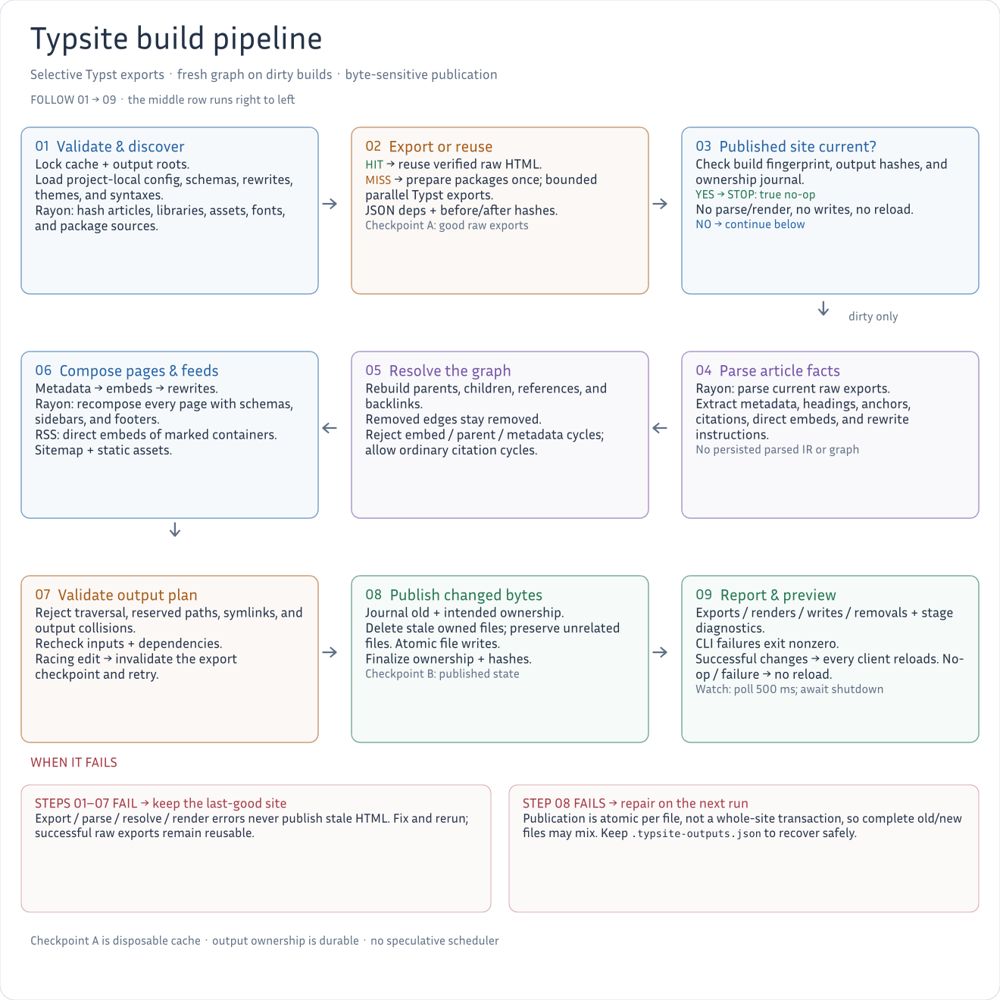

# Typsite
[ [English](./README.md) | **中文** ]

<div style="text-align: center;">

</div>

<div style="text-align: center;">
<a href="resources/root/migrate-to-018.typ" title="迁移到 Typsite 0.1.8">迁移到 Typsite <span style="color: #22d3ee;">0.1.8</span></a>
</div>

<div style="text-align: center;">
<a href="https://typ.rowlib.com/migrate-to-017" title="迁移到 Typsite 0.1.7">迁移到 Typsite <span style="color: #22d3ee;">0.1.7</span></a>
</div>

<div style="text-align: center;">
<a href="https://typ.rowlib.com/migrate-to-016" title="迁移到 Typsite 0.1.6 [https://typ.rowlib.com/migrate-to-016]">迁移到 Typsite <span style="color: #22d3ee;">0.1.6</span></a>
</div>

## 1. 介绍

Typsite 是一个用于构建静态网站的工具，其文章内容由纯 `Typst` 编写，经由 `Typsite` 进行处理后，最终生成一个健全的静态站点。


## 2. 功能

- `Typst` 的常规表达
- 框架: 标题递增、小节模板、侧边栏、页脚
- 富文本：段落、小节、引用、代码块、数学公式、注脚、页面嵌入
- 将 Typst math 转换为 Mathml （自动检测math-font)
- 支持现代 Web 技术规范，如 HTML5、CSS3 和 JavaScript（ES6+）
- 自动安装 typst-packages, 在 watch-mode 下自动同步包文件
- 链接/注脚 SVG (0.1.7+)
- 增量编译, 实时预览
- RSS 2.0 订阅，可选摘要或全文，并生成站点地图

## 3. Typst 简介

Typst 是一种现代化的排版系统，类似于 LaTeX，但设计更为简洁、易学，它主要用于创建学术论文、书籍、报告等需要精美排版的文档。

你可以在这里查看其官方英文文档：[Typst Document](https://typst.app/docs/)
对于Typst的中文教程，我强烈推荐：[Typst 蓝书](https://typst-doc-cn.github.io/tutorial/introduction.html) (天呐，这位编者非常清楚地知道自己是在阐述一套本体论!).

此节的剩余部分将会介绍 Typst & HTML -> Typsite

### 3.1 Typst 的 HTML 导出功能

Typst 于 `0.13` 增加了 HTML 导出功能，包括 `html-export` 模式以及两个核心函数：`html.elem` 和 `html.frame` —— 我们可以利用这些函数来基于 Typst 编写以HTML+CSS为目标内容。

### 3.2 Typsite：基于 Typst 的静态站点生成器

受此启发，我用 `Rust` 开发了名为 `Typsite` 的静态站点生成器.

目前，Typst 的 HTML 导出:
- 对简单富文本已有良好支持
- 复杂样式需要用户通过 `html.elem` 函数手动编写
- 无法自动将所有 Typst 生态内容转换为 HTML
- 对于包含复杂 Typst 样式的内容，可以使用 `html.frame` 将其转为 SVG 并嵌入 HTML
- 对于每一次 compile, 只支持单文件 HTML 输出

对于详细的已支持内容与计划可以追踪这个 [issue: HTML export #5512](https://github.com/typst/typst/issues/5512)

虽然官方有计划支持自动 typst style -> HTML+CSS，但这并不会与 Typsite 产生任何冲突。 恰恰相反，Typst 的发展将使 Typsite 更加实用，因为 `Typsite` 主要职能是协调文章间的交互，并最终构建一套功能完善的静态网站。

## 4. 安装

- 通过模板: [Typsite Template](https://github.com/Glomzzz/typsite-template) (推荐, for linux / macos)
- 通过 [Release 页面](https://github.com/Glomzzz/typsite/releases/latest)下载二进制文件
    - 请使用 **Typst 最新稳定版**（当前已测试 **0.15.1**）。CI 同时检查 0.15.1 和最新稳定版。
- 通过 Nix & Flakes 构建
    - 请确保你已经开启了 `experimental-features = nix-command flakes`

```shell
git clone https://github.com/Glomzzz/typsite.git

cd typsite
nix build .
```

### 4.1 从源码构建与检查

请使用 **Rust 稳定版 1.89 或更新版本**，以及 Typst 最新稳定版：

```sh
cargo build --release --locked
cargo test --workspace --all-targets --locked
# 真实 Typst 测试，使用隔离的包目录，覆盖辅助函数、模板和完整演示站点：
cargo test --test typst_latest --locked -- --ignored
```

现有写作辅助函数、模板和命令行选项保持支持。构建过程现在会报告导出、渲染和写入失败，
不再把保留了过期输出的失败构建当作成功。增量导出跟踪 Typst 实际读取的文件；
需要更新时重新组合完整页面，但只写入内容发生变化的文件。

内部缓存可以重建。输出目录中的 `.typsite-outputs.json` 记录文件归属，
请保留它，以便安全清理已删除页面的输出。`clean` 会保护源文件和配置目录。
清理没有归属标记的旧缓存或输出目录时，先检查路径，再使用 `clean --force`；
源文件或配置目录不是默认位置时，请同时传入 `--input` / `--config`。
详见 [0.1.8 迁移指南](resources/root/migrate-to-018.typ)及
[构建架构、校验变化及限制](docs/refactor.md)。

### 4.2 运行内置演示站点

`init` 会把完整的中英文演示站点及迁移指南复制到新目录中。构建时不需要下载 preview 包：

```sh
typsite init --dir ./demo
cd demo
typsite compile
typsite compile --port 8080
```

访问 `http://localhost:8080/` 或 `http://localhost:8080/en/`。
也可以不初始化新项目，直接在仓库中构建 `resources` 下的演示站点：

```sh
cargo run --locked -- compile --input ./resources/root \
  --config ./resources/.typsite --cache ./target/demo-cache \
  --output ./target/demo-site
```

请保留 `publish/.typsite-outputs.json`，使用自定义输出目录时则保留该目录中的归属记录。
示例中的外部音乐播放器和网页字体需要浏览器联网，但不是构建依赖。

### 4.3 RSS 订阅

修改 `.typsite/options.toml` 已有的 `[site]` 配置：

```toml
[site]
base_url = "https://example.org"
title = "我的站点"
description = "笔记与文章"
rss_path = "/rss.xml"
rss_limit = 20
rss_content = "summary" # "summary"（默认）或 "full"
sitemap_path = "/sitemap.xml"
```

通过布尔元数据 `rss` 标记集合页，选择订阅条目：

```typ
#import "/lib/lib.typ": *
#show: schema.with("page")
#title[订阅集合]
#rss(true)
= #embed("./first-post.typ")
= #embed("./second-post.typ")
```

只有 **`rss: true` 页面的直接嵌入文章**进入 RSS，标记页自身始终排除。
嵌套嵌入、引用或父级关系不选出独立条目；多个集合的条目合并去重。
该标记默认是 false，不会继承；没有集合页时，订阅没有条目。
`#rss(false)` 只取消集合标记，不会排除被其他集合选中的文章。
站点地图仍包含所有编译文章。

运行 `typsite compile` 后，读者可订阅生成的 `publish/rss.xml`，每个页面也会加入 RSS
自动发现链接。摘要模式依次取非空的 `description`、`summary`、`abstract` 元数据；
全文模式还会在 `content:encoded` 中包含组合后的文章 HTML，不含站点导航或页脚。
普通链接和图片地址会转为绝对 URL，脚本会被移除。不同阅读器对 SVG、MathML 和站点专用
CSS 的支持不同。

`base_url` 留空会关闭 RSS 与站点地图；`rss_path = ""` 或 `rss_limit = 0` 只关闭 RSS。
条目按修改或发表时间元数据排序，不取当前构建时间，因此无变化的构建不会更新订阅文件。
日期格式、文章元数据示例和完整设置见 [Typst 文档](resources/root/index.typ)。

### 并行构建

Typsite 使用 **Rayon** 并行计算独立文件指纹、校验缓存、解析文章和渲染页面。
Typst 文章导出使用独立的有界 Rayon 池：默认按 CPU 预算选择，最多 **4 篇同时导出**，
并为 Typst 子进程分配 CPU 工作线程，避免每个子进程都占用全部核心。

```sh
typsite compile --jobs 4  # 也可用 -j 4
typsite compile --jobs 1  # 串行导出文章，降低峰值内存
```

`--jobs` 必须是正整数，只控制文章导出，不控制所有 Rayon 工作。
`RAYON_NUM_THREADS` 可另行调整文件指纹、解析和渲染，并影响默认导出预算。
显式设置过大的任务数可能增加内存使用。包在导出前统一准备，结果和缓存更新按源文件
顺序汇总；关系/元数据依赖和发布归属仍保持有序。只改变并发数不会使已有输出缓存失效。

实测结果与复现方法见[构建性能说明](docs/performance.md)。

### 4.4 迁移到 0.1.8

完整步骤见演示站点内置的 [Typst 中文迁移指南](resources/root/migrate-to-018.typ)
（[English](resources/root/en/migrate-to-018.typ)）。升级时请检查：

1. 备份文章、`root/lib` 和 `.typsite`。使用 Typst 最新稳定版（已测试 **0.15.1**）；
   从源码构建需要 **Rust 1.89+**。
2. 通过 `typsite init --dir ../typsite-018-reference` 生成参考项目，对照合并辅助函数与
   配置，不要在现有站点上直接初始化。更新 `root/lib/site.typ` 的公式回退函数；
   需要订阅集合时，在 `root/lib/lib.typ` 中导入 `rss`。内置 Typst 包仍使用
   **`@local/typsite:0.1.0`**，不要改成 0.1.8。
3. 保留输出目录里的 `.typsite-outputs.json`。旧内部缓存会自动重建；只有明确清理
   没有标记的旧目录时，才应检查路径后使用 `clean --force`。
4. 使用 RSS 时，填写 `[site].base_url`，并在集合页写 `#rss(true)`。
   **`rss` 默认是 false**，只有集合页直接嵌入的文章成为条目，集合页自身排除；
   通过 `rss_content = "summary"` 或 `"full"` 选择摘要或全文。
5. 运行 `typsite compile`，部署前检查退出状态。损坏的资源、嵌入/父级/元数据循环
   现在会明确失败，不再静默跳过或误报成功。

迁移指南还包含可复制的配置、安全清理、包隔离、RSS 排错及失败恢复步骤。

## 5. 架构 & 流程

[](./process.png)

按编号蛇形阅读：第一行从左到右，第二行从右到左，第三行再从左到右。
图中包含 Typst 增量导出与缓存复用、无变化时提前结束、当前文章与关系解析、完整页面及
订阅组合，以及安全的单文件原子发布。导出与发布使用独立检查点，红色区域区分发布前
失败和发布中途失败后的恢复。点击图片可查看完整尺寸的方形图。

README 预览和演示站点共用同一份 [Typst 图表源文件](resources/root/lib/process.typ)。
在仓库根目录使用内置字体重新生成预览：

```sh
typst compile --root . --font-path resources/.typsite/assets/fonts \
  --ignore-system-fonts --ppi 144 docs/process.typ process.png
```

[构建保证与限制](docs/refactor.md) ·
[演示文档源文件](resources/root/index.typ) ·
[在线文档](https://typ.rowlib.com)

## 贡献 

来和我一起壮大typsite!

## 鸣谢
- [kokic](https://github.com/kokic) : [kodama](https://github.com/kokic/kodama) for **Markdown + Typst + LaTeX SSG**
- [tola-rs](https://github.com/tola-rs) : [tola-ssg](https://github.com/tola-rs/tola-ssg) for **面向 Typst 的 SSG，专注内容**
